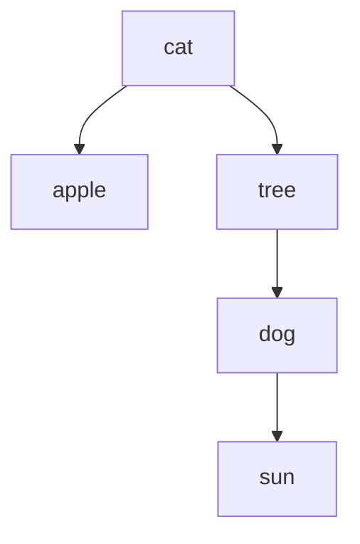

# Как устроена работа: объяснение для новичка

## Класс, объект и инкапсуляция

**Класс** описывает, какие данные хранит сущность и что с ней можно делать.
**Объект** — конкретный экземпляр класса. Например, класс словаря один,
а объектов-словарей можно создать несколько с разными словами.

```cpp
lab1::EnglishRussianDictionary dictionary;
```

Эта строка создаёт пустой объект `dictionary`. Его методы позволяют добавлять,
удалять и искать слова. Поля дерева находятся в разделе `private`:
меню не может напрямую сломать связи узлов. Это **инкапсуляция** — состояние
изменяется через предусмотренные операции класса.

В `.h` находится объявление: названия методов, параметры, типы результатов.
В `.cpp` находится реализация: действия внутри методов. Меню находится отдельно
в `cli`: оно только читает пользовательский ввод, вызывает операции и печатает
результат. Класс можно использовать в другой программе без этого меню.

## Несколько обозначений C++

| Обозначение | Что означает здесь |
|---|---|
| `std::string` | Строка, которая сама управляет своей памятью |
| `char*`, `const char*` | Указатель на C-строку; второй запрещает изменение через этот указатель |
| `std::pair` | Пара значений: английское слово и перевод |
| `const` | Объект/аргумент нельзя изменять через этот доступ |
| `auto` | Компилятор выводит тип из правой части выражения |
| `lab1::` | Пространство имён, в котором находятся классы лабораторной |
| `&` в типе | Ссылка на уже существующий объект |
| `*` в типе | Указатель: хранит адрес объекта или поля |
| `std::unique_ptr` | Единственный владелец объекта в динамической памяти |
| `std::vector` | Динамический массив, который сам управляет памятью |
| `std::move` | Разрешает передать владение ресурсом вместо копирования |
| `noexcept` | Метод обещает не выбрасывать исключения |
| `condition ? left : right` | Выбрать left при истинном условии, иначе right |
| `throw` | Сообщить об ошибке через исключение |
| `try/catch` | Выполнить действие и перехватить определённые ошибки |

Указатель, ссылка и копия — разные вещи. Ссылка обращается к существующему
объекту; копия содержит отдельные данные. Для словаря и вложенных множеств
реализованы независимые копии.
`unique_ptr.get()` возвращает обычный адрес объекта, сохраняя владельца;
`nullptr` обозначает отсутствие объекта. После перемещения источник можно
уничтожить или присвоить ему новое значение; его прежние данные не сохраняются.

## Перегрузка операторов

Перегрузка задаёт смысл символа для нашего класса. `+=` у словаря добавляет пару,
а `[]` ищет перевод. У множества `+` означает объединение, `*` — пересечение,
`[]` — проверку принадлежности. Эти операции явно реализованы методами
`operator+=`, `operator[]` и так далее.

```cpp
using Dictionary = lab1::EnglishRussianDictionary;
Dictionary dictionary;
dictionary += Dictionary::Entry{"cat", "кот"};
dictionary["cat"] = "кошка";
```

Первая операция создаёт узел. Вторая получает ссылку на перевод уже
существующего слова и меняет его. `operator+=` возвращает `*this`, то есть
ссылку на тот же словарь. Это позволяет последовательно применять операции.
`const`-версия `[]` разрешает только чтение перевода.

У `+=` один аргумент, поэтому слово и перевод передаются **одной парой**.
Перегрузки принимают пару `std::string`, пару `const char*` или пару `char*`.
Содержимое C-строк копируется в `std::string`, поэтому последующее изменение
исходных массивов не влияет на словарь. `nullptr` проверяется до копирования.

## Двоичное дерево поиска

Каждый `Node` содержит `entry`, `left`, `right`. Ключ — английское слово.
Слева находятся меньшие ключи, справа — большие. Сравнение строк выполняет C++.



Поиск `dog`: начинаем с `cat`; `dog` больше, идём направо к `tree`;
`dog` меньше `tree`, идём налево. Найден соответствующий узел.
Если путь закончился пустым указателем, слова нет.

`findNode` возвращает адрес найденного узла для чтения.
`findLink` возвращает адрес **поля unique_ptr**, владеющего найденным узлом
либо подходящим свободным местом. Благодаря этому одинаково обрабатываются
корень дерева и обычные потомки: поле-владелец можно заменить.

При добавлении ищется свободное место, создаётся новый узел и увеличивается
`wordCount_`. Если ключ уже есть, выбрасывается исключение до изменения данных.
`size()` возвращает счётчик, поэтому не обходит дерево.

## Удаление узла

Есть три содержательных случая:

1. Потомков нет — поле-владелец становится пустым.
2. Один потомок — он занимает место удалённого узла.
3. Два потомка — берётся самый маленький ключ правого поддерева.

В примере при удалении `cat` преемником будет `dog`. Его находят, переходя
вправо от `cat`, а затем максимально влево. Пары `cat` и `dog` меняют местами.
Затем удаляется прежний узел `dog`, который теперь содержит удаляемую пару.
Его правый потомок `sun` занимает освободившееся место под `tree`.
Преемник не имеет левого потомка, поэтому сложный случай сводится к простому.

`prepareRemoval` подготавливает нужное поле-владелец, а `operator-=` удаляет
сам узел и уменьшает счётчик ровно один раз. Отсутствующее слово не меняет словарь.

## Владение памятью, копирование и перемещение

`unique_ptr` освобождает свой узел автоматически. Все узлы принадлежат ровно
одному владельцу. Это RAII: срок жизни ресурса связан со сроком жизни объекта.
Ручных `new`/`delete` в программе нет; `make_unique` создаёт владельца безопасно.

Обычное копирование `unique_ptr` запрещено. Поэтому `cloneTree` создаёт отдельный
корень и с помощью списка ожидающих пар узлов копирует потомков.
`cloneChildren` копирует левую и правую ветви. В списке хранится пара:
адрес исходного узла и адрес соответствующего нового узла.
Структурная привязка `const auto [original, cloned]` даёт им понятные имена.

Присваивание копированием сначала создаёт готовую копию, затем обменивает
её со старым объектом через `swap`. Если создание копии не удалось,
старый объект не меняется. Самоприсваивание обрабатывается отдельно.

Перемещение передаёт владение деревом без копирования узлов. После перемещения
источник словаря пуст и имеет счётчик 0. `std::exchange` возвращает старый
счётчик и одновременно записывает в источник 0.

`clear` освобождает дерево итеративно. Пока есть левый потомок, выполняется
поворот, поднимающий его на место корня. Когда левого потомка нет, текущий
корень отсоединяется, а его правый потомок становится новым корнем. Перед
разрушением отсоединённого узла у него уже нет потомков, поэтому не возникает
глубокой рекурсивной цепочки деструкторов на вытянутом дереве.

`orderedEntries` обходит дерево в порядке «левое поддерево — узел — правое
поддерево» с явным списком предков. Результат — пары по возрастанию ключа.
Он используется для записи и сравнения словарей: одинаковые пары означают
равенство, даже если форма деревьев различается.

## Как представлено вложенное множество

В `Set` есть закрытый массив `elements_`. Один `SetElement` хранит либо
строковый атом, либо `unique_ptr<Set>`. Метод `isSet()` определяет вид элемента.
`asAtom()` и `asSet()` возвращают значение нужного вида или сообщают об ошибке.

Множество `{a, b, {c, d}}` содержит **три** элемента. Вложенные `c` и `d`
не являются отдельными элементами внешнего множества.
При добавлении вложенного множества создаётся глубокая копия. Доступ к ней
снаружи только через `const Set&`, поэтому её нельзя изменить и нарушить уникальность.

`SetElement` сам реализует глубокое копирование. Поэтому копирование массива
элементов в `Set` можно доверить компилятору с `= default`: каждый элемент
вызовет свой корректный конструктор копирования. Контейнер освобождает элементы,
а владельцы вложенных множеств — соответствующие объекты.

## Уникальность, принадлежность и равенство

`set[element]` ищет элемент через `std::find` и возвращает `bool`.
`add` сначала проверяет принадлежность и добавляет только новый элемент.
`remove` ищет элемент и удаляет найденный; при отсутствии возвращает `false`.

Для равенства множеств сначала сравнивается размер, затем принадлежность
каждого элемента второму множеству. `std::all_of` означает «условие выполнено
для каждого элемента». Поскольку дубликаты запрещены, этого достаточно.
Равенство вложенных множеств использует те же правила рекурсивно.
Поэтому `{a, b}` равно `{b, a}`, а `{a}` отличается от атома `"{a}"`.

При выводе `std::transform` получает текст каждого элемента,
`std::sort` упорядочивает эти тексты, и они соединяются запятыми.
Это обеспечивает одинаковый вывод одинаковых множеств. Дубликаты и порядок
математического множества определяются сравнением значений, а не сортировкой.

## Объединение, пересечение и разность

Объединение начинает с копии A и добавляет элементы B; повторные элементы
`add` автоматически пропускает. Пересечение перебирает A и оставляет только
те элементы, которые есть в B. Разность перебирает A и оставляет те,
которых в B нет. Операнды обычных `+`, `*`, `-` не изменяются.

Составные операции `+=`, `*=`, `-=` изменяют левый операнд.
`A += A` ничего не добавляет; `A *= A` сохраняет A; `A -= A` делает A пустым.
Эти случаи проверяются тестами.

## Булеан: множество всех подмножеств

Начинаем со списка, содержащего одно пустое подмножество. Для каждого элемента
исходного множества копируем все уже имеющиеся подмножества, добавляем к копиям
этот элемент и дописываем копии в список.

| Шаг для `{a, b}` | Подмножества |
|---|---|
| До элементов | `{}` |
| После `a` | `{}`, `{a}` |
| После `b` | `{}`, `{a}`, `{b}`, `{a, b}` |

На каждом шаге число удваивается: получается 2^n. `appendSubsets` выполняет
один шаг, `powerSet` повторяет его для всех элементов и превращает список
в множество вложенных множеств. Повторную проверку уникальности внешнего
результата делать не нужно: алгоритм создаёт разные подмножества.

`checkedSubsetCount` проверяет лимит **до** построения и делает проверку перед
удвоением, чтобы не допустить переполнение числа. Лимит 4096 можно изменить
аргументом `powerSet`. У пустого исходного множества результат `{{}}`:
один элемент — пустое подмножество.

## Как разбирается строка

`parseSet` ожидает `{`, затем элементы, разделённые запятыми, и `}`.
`parseElement` видит `{` и вызывает разбор вложенного множества; иначе
читает атом через `parseAtom`. Поэтому разбор рекурсивный: внутреннее множество
имеет ту же грамматику, что и внешнее. Пробелы между частями пропускаются.

`std::quoted` читает и пишет строки в кавычках с экранированием. Атомы без
кавычек заканчиваются на запятой, `}` или пробельном символе.
`needsQuotes` использует `std::any_of`: кавычки нужны, если хотя бы один символ
атома специальный. `requireEnd` проверяет, что после объекта нет лишнего текста.
Ограничение глубины предотвращает слишком глубокий рекурсивный разбор.

## Потоки, файлы и ошибки

`<<` записывает объект в поток: это может быть консоль, файл или строка.
`>>` читает его из потока. Классы не привязаны к `cin`/`cout`.
Чтение сначала создаёт отдельный объект. Если всё успешно, `swap` заменяет
текущие данные. При неверном формате у потока устанавливается `failbit`,
а прежний объект сохраняется.

`loadFromFile` открывает файл, читает отдельный словарь, проверяет конец файла
и только затем заменяет объект. Меню ловит исключения, печатает сообщение
и возвращается к следующей команде. При завершении ввода программа выходит.
Сохранение проверяет результат после закрытия файла, включая возможную ошибку записи.

## Тесты, покрытие и CI

Catch2 сравнивает ожидаемый результат с фактическим. Тесты включают обычные
операции, отсутствующие элементы, ошибочные строки, все случаи удаления
узлов, независимость копий, самоприсваивание, вложенные множества и булеан.
Меню тестируется со строковыми потоками, а отдельная проверка запускает
настоящие исполняемые файлы.

Покрытие строк измеряет gcovr после выполнения проверок с инструментированным
GCC-кодом. Большое покрытие не доказывает отсутствие всех ошибок, поэтому
сами проверки должны утверждать содержательные результаты.
CI повторяет сборку, проверки и генерацию документации на GitHub.
Releases публикуется отдельным шагом после успешных проверок тега из `main`.

## Проверьте, что можете объяснить

1. Почему `wordCount_` увеличивается только после создания узла?
2. Что возвращает `findLink`, и чем это отличается от `findNode`?
3. Почему у преемника при удалении нет левого потомка?
4. Почему обычное копирование владельца `unique_ptr` запрещено?
5. Чем `dictionary["cat"]` отличается от `set[element]`?
6. Почему `{a, {b, c}}` имеет мощность 2, а не 3?
7. Почему сравнение множеств не зависит от порядка?
8. Почему у пустого множества есть одно подмножество?
9. Как сохраняются прежние данные при ошибке чтения?
10. Почему тесты, консольное меню и Doxygen решают разные задачи?
